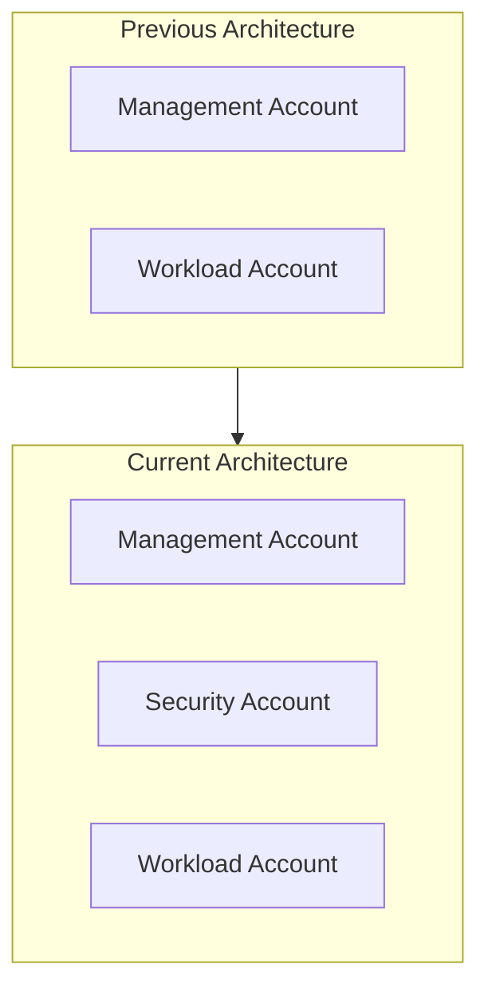
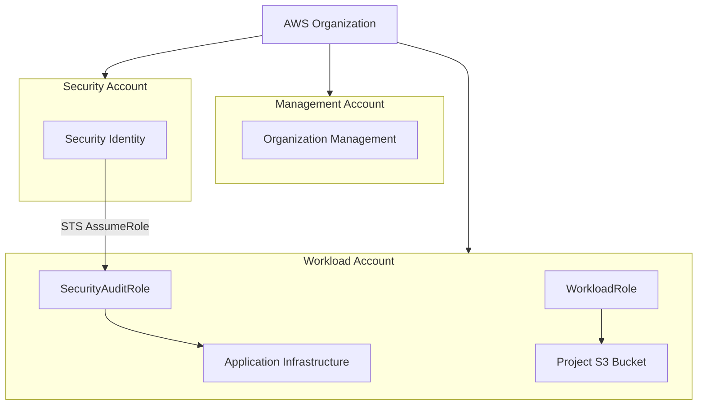
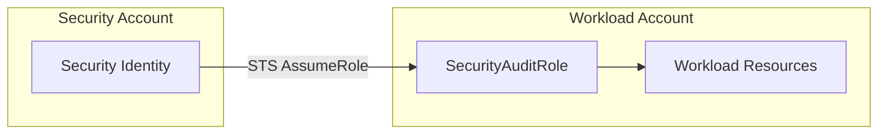
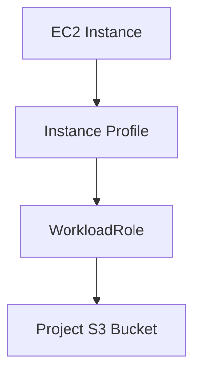
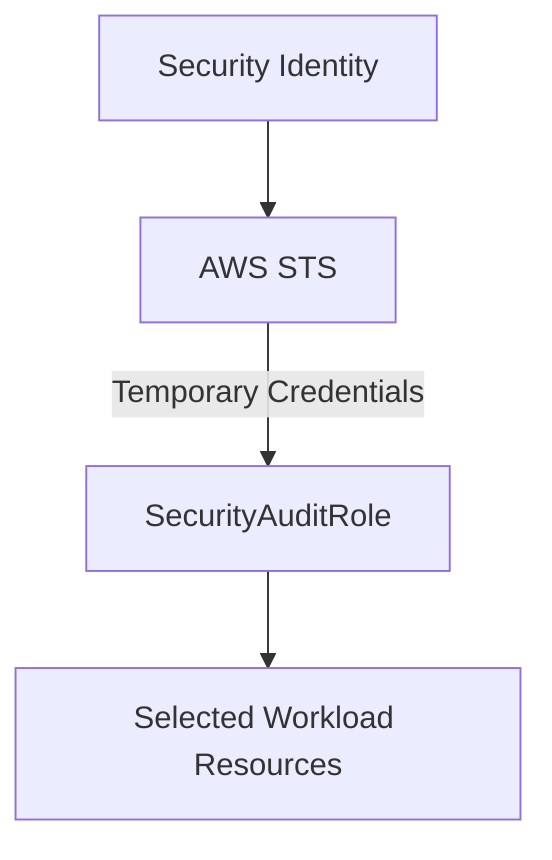

# 03 - Cross-Account AssumeRole

## 1. Context

The previous architecture layer established a multi-account AWS environment using AWS Organizations, with a Management Account and a Workload Account.

This architecture layer introduces cross-account access to support security operations independently from application workloads.

## 2. Architectural Evolution

The architecture evolves by introducing a dedicated Security Account alongside the existing Management and Workload Accounts.

The Security Account provides a separate context for security administration. It allows security identities to access selected resources in the Workload Account through cross-account IAM role assumption.

AWS Security Token Service (STS) is used to establish this access by allowing an authorized identity in the Security Account to assume a dedicated IAM role in the Workload Account.

This separation keeps security access independent from the IAM role used by application workloads.

### Architecture Evolution Schema

The following schema illustrates the evolution from the previous two-account architecture to the current three-account architecture.

## 3. Current Multi-Account Architecture

The current architecture is organized into three AWS accounts, each with a separate responsibility.

### Account Responsibilities

**Management Account**

- Manages the AWS Organization.
- Provides the central organization management context.
- Remains separate from application workloads and security auditing.

**Security Account**

- Provides a dedicated security administration context.
- Hosts security identities used to access resources in other accounts.
- Acts as the source account for cross-account security access.

**Workload Account**

- Hosts application infrastructure and resources.
- Contains the IAM role used by application workloads.
- Contains a separate IAM role dedicated to cross-account security auditing.

## 4. Cross-Account Access Flow

Cross-account access allows an identity in one AWS account to access selected resources in another account without requiring permanent credentials in the target account.

In this architecture, the Security Account is the source account and the Workload Account is the target account.

### Access Flow Schema

### Access Sequence

1. A security administrator authenticates in the Security Account.
2. The security identity requests access to the target role in the Workload Account.
3. AWS STS processes the AssumeRole request.
4. If the request is authorized, STS provides temporary security credentials.
5. The security identity uses these temporary credentials to access the resources permitted by the assumed role.

The target role defines the access available after successful role assumption.

## 5. IAM Role Separation

The Workload Account contains two distinct IAM roles with different responsibilities.

### WorkloadRole

The `WorkloadRole` is dedicated to application workload access.

It allows an EC2 instance to access the required AWS resources without embedding long-term credentials in the application.

### SecurityAuditRole

The `SecurityAuditRole` is dedicated to cross-account security auditing.

It allows an authorized security identity from the Security Account to assume a role in the Workload Account and inspect selected resources.

These roles have separate responsibilities and access relationships:

- `WorkloadRole` supports application execution.
- `SecurityAuditRole` supports cross-account security auditing.

The security audit role does not replace or modify the workload role.

## 6. Architectural Boundaries

This architecture introduces cross-account access for security auditing. It does not introduce cross-account infrastructure deployment.

These are two separate architectural concerns:

**Cross-account security access**

An identity in the Security Account assumes a role in the Workload Account to access selected resources.

**Cross-account infrastructure deployment**

A deployment identity assumes a role in another account to create or modify infrastructure.

The current architecture addresses cross-account security access only. Infrastructure deployment remains outside this architecture layer.